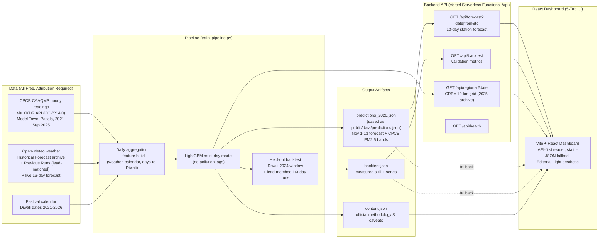

# Architecture - Diwali Air Quality Prediction (Round 2)

## Data Pipeline & Application Flow

## Backend API (Round 2)

Four serverless endpoints (Node, Vercel Functions, `api/*.js`) serve the model-generated artifacts over HTTP with query filtering. This is a read API over pre-computed outputs - no on-request inference, no placeholders. The React client calls the API first and falls back to the bundled static JSON on any failure, so the UI is identical and resilient either way.

| Endpoint | Query | Returns |
|---|---|---|
| `/api/health` | - | liveness `{status:"ok"}` |
| `/api/forecast` | `?date=YYYY-MM-DD` or `?from=&to=` | station forecast rows (default: all 13, Nov 1-13 2026) + station/scope/training metadata; 404 + available dates for out-of-range dates |
| `/api/backtest` | - | full validation artifact (held-out windows, lead-matched scores, caveats) |
| `/api/regional` | `?date=YYYY-MM-DD` | CREA 10-km regional grid (15x15 cells around Patiala) for one 2025 archive date (default 2025-10-20, Diwali 2025); 404 + available dates otherwise |

Try: `https://patiala-diwali-dashboard.vercel.app/api/forecast?date=2026-11-08`

## Component & UI Structure (5-Tab Layout)

The web dashboard is implemented as a thin, static Vite + React client reading JSON artifacts from `public/data/` with zero synthetic or hardcoded numbers in UI code:

1. **Header (`src/components/Header.tsx`):**
   - Displays station identity (`Model Town, Patiala · site_1437`) and target forecast event (`Diwali 2026 - Nov 8`).
   - Eyebrow attribution: `DATA: CPCB CAAQMS (PPCB STATION) VIA XKDR, CC-BY 4.0`.
   - Top action controls: `Methodology` modal toggle, `Ingest JSON` modal toggle, `Test Pending` state preview toggle, and live data `Reload` button.
   - Persistent one-line **Station-Level Truth Banner** visible across all tabs.

2. **Main Application Controller (`src/App.tsx`):**
   - Manages asynchronous loading of `predictions.json` and `backtest.json`.
   - Controls active tab selection among the 4 dashboard views.
   - Handles fallback rendering for data loading, pending states, and custom file uploads.

3. **Tab 1: Forecast (`src/components/ForecastHero.tsx`):**
   - **Interactive Day Picker:** Horizontal button row covering the 13-day Diwali horizon (`Nov 1-13`), pre-selecting **Diwali Day (Nov 8)** and marking **Nov 10** as `★ Peak`.
   - **ONE Big Answer:** Immediate 5-second summary of the selected day with large serif PM2.5 concentration numeral, official CPCB band pill, days before/after Diwali, multiple of CPCB standard, and health advisory text.
   - **Compact 4-Stat Row (`src/components/KpiSummary.tsx`):** Summary metrics for Peak Forecast (`143.9 µg/m³ · Nov 10`), Diwali Day Forecast (`119.8 µg/m³ · Nov 8`), CPCB Standard Exceedance (`2.4x the 24-hr limit at predicted peak (Nov 10)`), and Held-Out Test MAE (`17.5 µg/m³ at 1-day lead`).

4. **Tab 2: Graph (`src/components/ForecastChart.tsx`):**
   - Full 13-day PM2.5 trajectory curve built with Recharts `AreaChart`.
   - Reference markers for Diwali Day (D0, Nov 8), CPCB 24-hr standard (60 µg/m³), and WHO guideline (15 µg/m³).

5. **Tab 3: Daily list (`src/components/PredictionTable.tsx`):**
   - Comprehensive schedule table for all 11 forecast days with timeline offsets (`1 day before/after`), CPCB band indicators, sorting, and optional health advisory drawer.

6. **Tab 4: Model & Method (`src/components/BacktestChart.tsx` & `src/components/MethodologySection.tsx`):**
   - **Retrospective Backtest Chart:** Evaluates held-out Diwali 2024 window (Oct 20 - Nov 10, 2024; 22 days) comparing Actuals vs Retrospective Model vs Naive Climatology Baseline with interactive series filtering.
   - **Model Skill Summary:** Comparative evaluation cards detailing lead-matched 1-day ahead (17.5 µg/m³), 3-day ahead (19.7 µg/m³), retrospective (17.2 µg/m³), and naive baseline (20.2 µg/m³).
   - **Methodology Tabs:** In-depth documentation on Station Truth (`site_1437`), LightGBM Pipeline & Skill, Data Windows & Sources, and Limitations & Caveats.

7. **Modals & Defensive Fallbacks:**
   - **File Uploader Modal (`src/components/FileUploaderModal.tsx`):** Drag-and-drop ingestion interface validating user-supplied `predictions.json` and `backtest.json` schemas in-browser.
   - **Data-Pending State (`src/components/DataPendingState.tsx`):** Strict awaiting screen rendered when prediction files are absent; enforces scientific integrity with zero fake or randomized numbers.

## Design Rules Encoded in the Pipeline

- **Strict Temporal Separation:** Training rows strictly precede test windows (e.g. training ends 2024-10-19, backtest starts 2024-10-20; split asserted in code).
- **Realistic Forecast Evaluation:** Weather inputs during backtesting are drawn from genuine historical forecast runs (Open-Meteo Previous Runs API at 1-day and 3-day leads) rather than near-analysis reanalysis.
- **Thin Client Decoupling:** The React UI consumes immutable JSON artifacts; pipeline retraining and data downloading (`pull_data.sh`, `train_pipeline.py`) run independently.
